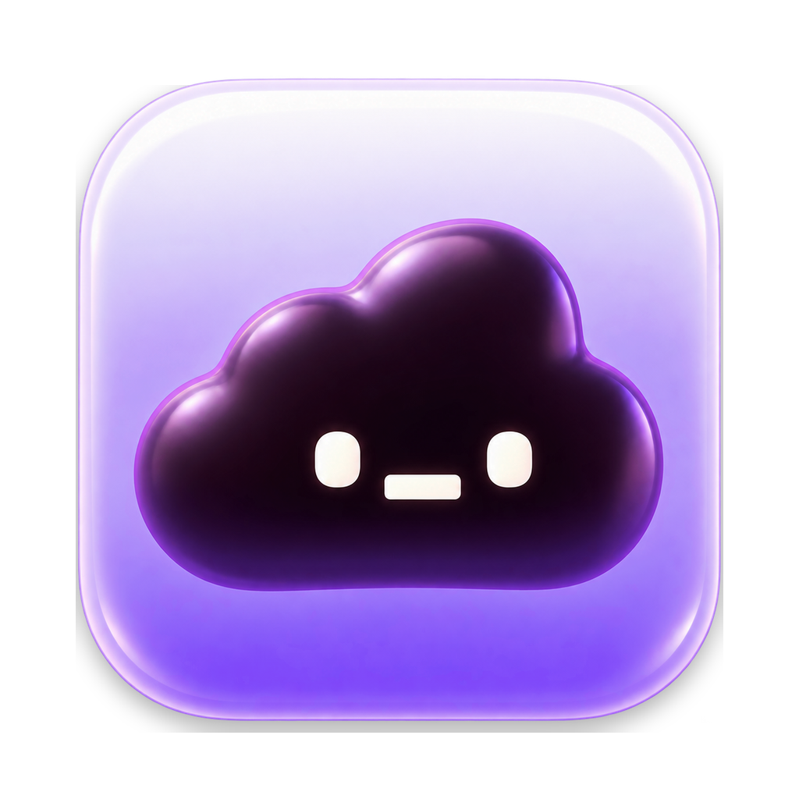

<p align="center">
  
</p>

<h1 align="center">Dynamic Ledge</h1>

<p align="center">
  The iPhone's Dynamic Island, but for your MacBook's notch.
</p>

<p align="center">
  <a href="https://github.com/shandilyaswagat/dynamic_ledge/releases/latest"></a>
  
  <a href="LICENSE"></a>
  
</p>

<p align="center">
  <b><a href="https://github.com/shandilyaswagat/dynamic_ledge/releases/latest/download/DynamicNotch.dmg">Download it here</a></b>
  &nbsp;·&nbsp; or with Homebrew: <code>brew install --cask shandilyaswagat/tap/dynamic-ledge</code>
</p>

<p align="center"><sub>Called Dynamic Notch until 1.4.0. Same app, new name.</sub></p>

---

The notch on my MacBook just sits there doing nothing. I wanted it to work like the island on
my phone, so I made this.

When something's going on, the notch stretches out and shows it. When nothing is, it tucks back in
and you forget it's there.

Here's what it shows:

- Whatever music is playing, from any app (or just the ones you pick, like Spotify), with the
  album art and play/pause/skip
- Timers, counting down right next to the camera
- Calls on FaceTime, Zoom, Meet, Teams and the rest, with how long you've been on
- Your next calendar event, plus a heads up 5 minutes before it starts
- Volume and brightness when you change them
- A heads up when you plug in your charger or your battery gets low
- Your AirPods or headphones connecting

And when you click it, you get a little home base right under the notch:

- **Home** with whatever's live (a call, the mic, your music) up front, then your next event,
  quick timers and your favourite Shortcuts, side by side. Hang up or pause right from Home, or
  click a live card to open it. Tap the timer for any length, Pomodoro or a stopwatch, and tap
  your next event to see the month (click any day in it to see what's on)
- **Lyrics** for songs that have timed lyrics, line by line as they're sung
- **Files Tray**, a handy spot to drop files you'll need again in a minute. Drag files onto the notch
  to put them there, and drag them back out when you're ready. Pin the ones you want to keep around
- **Clipboard**, the last few things you copied. Search them, pin the ones you reuse, and click one
  to copy it again. Passwords are skipped, and only pinned clips are saved
- **Notes**, a little scratchpad for phone numbers, to-dos, whatever
- **Mirror**, a quick look at your camera before you hop on a call, with a button to turn the
  camera off

Drag files onto the notch and you can also AirDrop them straight from there.

Working on a document? Save it, then drag its window by the title bar onto the notch and let go
over **Tray**. The first time, your Mac will ask you to allow Dynamic Ledge in Accessibility (and
sometimes Automation). Tray is a scratch space: it holds up to 30 things and clears when you quit
the app, apart from anything you've pinned, without ever touching your original files.

Everything else lives behind the grid button at the top right: music, the timer, stopwatch,
calendar, today's reminders, a scratchpad, your camera mirror, Stats and Keep Awake (stops your
Mac from sleeping). Each one has a shortcut too, like ⌃⌥R for the timer.

Next to Home at the top left sit up to three shortcuts of your own. They start as Files and
Clipboard, and Files shows how many things are in your Tray. To change them, open the
grid and hold any feature, then click features to add them or click a ticked one to remove it.
Click **Done** when you're happy.

Like things wide? Pick **Elongated** in Settings › Appearance and Home stretches across the top
of your screen, with everything in one long row you can scroll sideways: music you can scrub, a
camera mirror, your week with one-click **Join** for Meet, Zoom, Teams and Webex calls, notes you
can format, a wheel timer and a to-do list.

Want to see your timer or music while your Mac is locked? Turn on **Show on Lock Screen** in
Settings › General. It's off by default, because anyone at your Mac can see it.

Want to keep an eye on your Mac? Click the **Stats** tile in the grid to switch it on. Your memory and CPU show
up beside the camera whenever nothing else is going on, and a click shows memory, CPU, free disk
space and network speed. It's all read on your Mac and never leaves it.

A few more handy bits: a mute button for your mic during calls, a red **Hang Up** button for
Teams, Zoom, Webex and WhatsApp calls, and (if you switch it on in Settings) a heads-up when a
download finishes. The first time you use Hang Up, macOS asks for Accessibility access. WhatsApp
uses its accessible Leave call or End call control; if it can't find it, the call stays on and the
notch tells you.

Got a second screen? It stays on your MacBook by default. In Settings you can pick another screen,
have it follow your pointer, or show it on all your screens at once. Screens without a notch get
a notch too: it stays out of sight until something's going on, and you can bring it out by resting
your pointer at the top centre of the screen for a moment.

You can make it small, medium or large, whatever looks right on your screen.

It doesn't need an account and doesn't track anything. The only time it goes online is a quick
daily check for a new version, which you can turn off in Settings. All of this is free.

## Installing it

**The easy way, if you use [Homebrew](https://brew.sh):**

```bash
brew install --cask shandilyaswagat/tap/dynamic-ledge
```

That's it, no extra steps. Otherwise, download it yourself:

Heads up: I haven't paid Apple for a developer account yet, so the first time you open the app
your Mac will grumble about it. You only have to deal with this once and it takes about a minute.

1. Download [DynamicNotch.dmg](https://github.com/shandilyaswagat/dynamic_ledge/releases/latest/download/DynamicNotch.dmg)
   (the file keeps the app's old name, so older versions can still update) and open it.
2. Drag **Dynamic Ledge** into your **Applications** folder.
3. Go to Applications and double-click **Dynamic Ledge**. Your Mac will say it couldn't open it.
   Just hit **Done**.
4. Open **System Settings**, go to **Privacy & Security** and scroll down a bit. You'll see a line
   saying Dynamic Ledge was blocked. Click **Open Anyway**, type your password (or use Touch ID)
   and click **Open Anyway** one more time.
5. That's it. The notch will say hi to you by name with a little wave, and a capsule icon shows
   up in your menu bar.

If you're comfortable with Terminal, you can skip steps 3 and 4. After dragging the app into
Applications, run this and then open the app like normal:

```bash
xattr -dr com.apple.quarantine "/Applications/Dynamic Ledge.app"
```

## Using it

| If you want to | Do this |
|---|---|
| Open Home or one of your shortcuts | Click the notch, then pick it at the top left |
| Open anything else | Click the notch, then the grid button at the top right |
| Change your shortcuts | Open the grid, hold any feature, then click features to add or remove them |
| Start a timer, a focus session or a shortcut | Click the notch, then tap it on Home |
| See more about something | Click it |
| Close it | Click anywhere else, or just move your mouse away (Notes stays open until you click away or press Escape) |
| Skip a song | Swipe left or right on the music with two fingers |
| Open or close it without clicking | Choose **Hover** in Settings › General, or pull down on the notch with two fingers; push up to close |
| Get back to Home | Click the back arrow at the top left |
| Keep files for later, or AirDrop them | Drag them onto the notch and drop on **Tray** or **AirDrop** |
| Pause a timer, skip a song, open settings | Right-click the notch |
| Change the size, pick your Shortcuts, turn stuff off | Click the capsule icon in the menu bar, then **Settings…** |

You'll probably want to switch on **Open at login** in Settings so it's always running.

## Things people ask

**I installed it and nothing's showing up.** That's on purpose. It stays hidden until there's
something to show, like music or a timer. Hover over the notch and it'll puff out a little. Click
it to open it.

**My Mac doesn't have a notch.** It still works. You'll get a notch at the top centre of the
screen whenever there's something to show. To open it, rest your pointer there for a moment until
it slides down, then click.

**My music isn't showing.** Play something and give it a second. The app uses a hidden bit of
macOS to see what's playing. If Apple ever removes that in an update, music will stop showing up
but everything else will keep working. If you picked **Only these apps** in Settings ›
Activities, check the app is ticked there.

**Can I stop videos from showing up?** Yes. In Settings › Activities, set **Show music from** to
**Only these apps** and tick just your music app, like Spotify. YouTube and other websites play
through your browser, so leave the browser unticked.

**Is it safe?** All the code is right here in this repo, so anyone can look through it (it's free
software, see [License](#license)). The app
doesn't collect anything. It goes online only to check GitHub for a new version and, if you have
Lyrics on, to look up the song that's playing on lrclib.net (just its name, artist, album and
length). That warning during install only shows up because
I haven't registered the app with Apple yet. I'm planning to do that later.

**Why is it asking for my camera or calendar?** Only if you use those bits. It asks for the camera
the first time you open Mirror, and for your calendar when you click Connect. Nothing gets
recorded or sent anywhere. Say no and everything else keeps working.

**Does it keep what I copy?** Only while the app is running, and only the last 20 bits of text.
The only clips saved to disk are the ones you pin, so they're still there next time. Anything a
password manager marks as private is skipped. Don't want it at all? Turn off Clipboard in
Settings and it stops watching right away.

**How do I update it?** It updates itself. When a new version is out, the notch lets you know;
click it, or go to Settings › About, and hit **Install and Relaunch**. Every update is checked
before it's installed, so a tampered download can't get in. With Homebrew, run
`brew upgrade --cask dynamic-ledge`. Prefer doing it by hand? Download the new version and drag
it into Applications again. Replace the old one when it asks. Your settings stay put.

**The button says Download instead of Install and Relaunch.** Your copy can't update itself (for
example, one you built yourself). Download [the latest version](https://github.com/shandilyaswagat/dynamic_ledge/releases/latest/download/DynamicNotch.dmg)
by hand once and drag it into Applications. From then on, updates install right from Settings.

**It's asking for permissions again after an update.** That's macOS being careful, because the
app isn't registered with Apple yet. Just allow them again.

**How do I get rid of it?** Click the capsule icon in the menu bar and pick **Quit Dynamic Ledge**,
then drag the app from Applications to the Trash. If you want to clear out everything it saved too,
delete `~/Library/Application Support/Dynamic Ledge` (or `Dynamic Notch`, from older versions) and
`~/Library/Preferences/com.rectircle.DynamicNotch.plist`.

**Why did Dynamic Notch become Dynamic Ledge?** Same app, new name, from 1.4.0. If you had
Dynamic Notch, it updates to Dynamic Ledge like any other update, renames itself in your
Applications folder, and keeps all your settings. Homebrew moves you to the new name on its own.

## What you need

- macOS 14 (Sonoma) or newer
- Works on Apple silicon and Intel Macs, but it's really made for MacBooks with a notch

## What's new

**1.4.0**, the biggest update yet:

- A new name, **Dynamic Ledge**, and a new icon
- Your own shortcuts beside Home (hold a feature in the grid to pick them)
- The **Elongated** layout, with Home stretched across the top of your screen
- Your timer, music or charging on the **Lock Screen** (off until you turn it on)
- **Hang Up** for Zoom, Teams, Webex and WhatsApp calls, right from the notch
- An **Update** button in the notch when a new version is out
- Click any date in the Calendar to see that day
- Now free software under the GNU GPL

Everything that changed in each version is in the [changelog](CHANGELOG.md).

## License

Dynamic Ledge is free software, © 2026 Swagat Shandilya and contributors. You can use it, share it
and change it under the [GNU General Public License, version 3](LICENSE) or (at your choice) any
later version. If you share a changed version, it has to stay free under the same license, with
its source code available.
