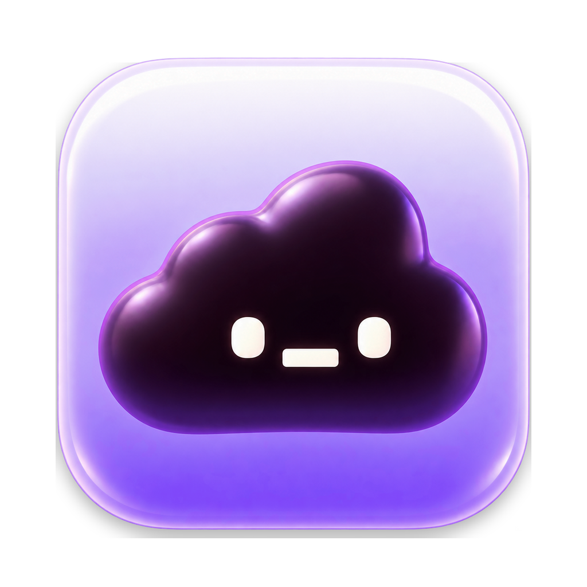

<p align="center">
  
</p>

<h1 align="center">Dynamic Ledge</h1>

<p align="center">
  The iPhone's Dynamic Island, but for your MacBook's notch.
</p>

<p align="center">
  <a href="https://github.com/shandilyaswagat/dynamic_ledge/releases/latest"></a>
  
  <a href="LICENSE"></a>
  
</p>

<p align="center">
  <b><a href="https://github.com/shandilyaswagat/dynamic_ledge/releases/latest/download/DynamicNotch.dmg">Download it here</a></b>
  &nbsp;·&nbsp; <a href="#install-it">How to install</a>
  &nbsp;·&nbsp; <a href="#privacy-and-permissions">Privacy</a>
</p>

---

The notch on my MacBook just sat there doing nothing, so I made it useful. When something's
going on, it stretches out and shows you. When nothing is, it tucks away and you forget it's there.

Free, no account, nothing about you collected.

## What it does

**On its own, when something happens:**
- Music from any app, with album art, controls, lyrics and a switch for where sound plays
- Timers, counting down beside the camera
- Calls (FaceTime, Zoom, Meet, Teams, WhatsApp…) with mute and Hang Up
- Your next meeting, with a heads-up 5 minutes before
- Charging, low battery, volume and brightness
- Downloads finishing (if you turn it on)
- Allow or Deny Claude Code, Codex, Copilot CLI, Antigravity and Cursor, and a heads-up when
  they finish (if you turn it on)

**When you click it:**
- **Home** with what's live, your next event, quick timers and Shortcuts
- **Tray** for files you need again soon. Drop them on the notch, drag them out later, or AirDrop
  them. Zip them, merge PDFs and images into one PDF, or convert an image to another format
- **Clipboard** with the last 20 things you copied, and the text from images you copy (if you turn it on)
- **Notes**, a little scratchpad
- **Mirror** to check your camera before a call
- Calendar, reminders, stopwatch, Stats and Keep Awake behind the grid button

Make it small, medium or large, black or **Glass**, springy or calm, or stretch Home across the
top with **Elongated**. No notch on your Mac or second screen? You still get one, or a floating **Pill**.

<a id="installing-it"></a>

## Install it

You need macOS 14 (Sonoma) or newer.

**With Homebrew** (easiest), paste this in Terminal:

```bash
brew install --cask shandilyaswagat/tap/dynamic-ledge
```

**Or download it yourself:**

1. Download [DynamicNotch.dmg](https://github.com/shandilyaswagat/dynamic_ledge/releases/latest/download/DynamicNotch.dmg).
2. Open it.
3. Drag **Dynamic Ledge** into **Applications**.
4. Eject the installer disk (click ⏏ next to it in Finder's sidebar).
5. Open **Dynamic Ledge** from Applications.
6. Your Mac says it can't open it. Click **Done**.
7. Open **System Settings › Privacy & Security** and scroll down.
8. Click **Open Anyway** next to Dynamic Ledge, then confirm with your password or Touch ID.

Done. The notch waves hi, and a capsule icon appears in your menu bar.

> **Why steps 6–8?** The app isn't registered with Apple yet (that costs money I haven't spent
> yet), so macOS asks you to confirm once. You only do this the first time.

**Tip:** turn on **Open at login** in Settings so it's always there.

## Use it

- **Click the notch** to open it. Move away or click anywhere else to close it.
- **Grid button** (top right) opens everything else.
- **Drag files** onto the notch to drop them in Tray or AirDrop.
- **Right-click** the notch for quick controls.
- **Settings:** click the capsule icon in the menu bar, then **Settings…**

Nothing showing? That's normal. It stays hidden until there's something to show. Hover over the
notch to peek, or click it.

## Update it

It updates itself. When there's a new version, the notch tells you. Click **Update Now** and
you're done (or let it install updates on its own in Settings › General › Software Update). Every update is checked before it installs, and your settings stay.

With Homebrew: `brew upgrade --cask dynamic-ledge`

## Remove it

1. If you turned on any coding assistants, switch them off in **Settings › General › Coding Assistants**
   first.
   That removes what Dynamic Ledge added to their settings files.
2. Click the capsule icon in the menu bar and choose **Quit Dynamic Ledge**.
3. Drag **Dynamic Ledge** from Applications to the Trash.
4. To clear everything it saved too, delete these:
   - `~/Library/Application Support/Dynamic Ledge`
   - `~/Library/Preferences/com.rectircle.DynamicNotch.plist`

With Homebrew: `brew uninstall --cask dynamic-ledge`, then step 4.

## Privacy and permissions

**The short version:** no account, no ads, no tracking. What you do on your Mac stays on your Mac.
All the code is here, so anyone can check.

**It only goes online for:**

| What | Why | What's sent |
|---|---|---|
| GitHub | Checking for updates, once a day | Nothing about you |
| [TelemetryDeck](https://telemetrydeck.com) | Counting how many Macs use and update the app, once a day | A random ID (hashed, not tied to you), the app version (and the one before, after an update) and macOS version |
| [lrclib.net](https://lrclib.net) | Lyrics, only if Lyrics is on | The song's name, artist, album and length |

No names, emails, files, clipboard, calendar or anything you type ever leave your Mac.

**Permissions** are only asked for when you first use the feature that needs them. Say no and
everything else keeps working.

| Permission | Used for | Asked when |
|---|---|---|
| Camera | Mirror. Nothing is recorded | You open Mirror |
| Calendar | Your next event | You click Connect |
| Reminders | Today's to-dos | You click Connect in Reminders |
| Accessibility | Hang Up, and dragging a document window into Tray | You first use one of them |
| Automation | Reading which file or web page a window shows, for Tray | You drag a window into Tray |
| System audio | Live music bars. The sound is only measured, never recorded or sent | You turn on Live music bars |

**What it keeps on your Mac:**
- **Clipboard:** the last 20 bits of text, in memory only. Gone when you quit, except clips you
  pin. Anything a password manager marks private is skipped. Turn Clipboard off any time.
  With **Text from images** on, a copied picture's text is read on your Mac and kept like any
  other clip; the picture itself isn't kept.
- **Tray:** links to your files, never copies. Your original files are never changed. Clears when
  you quit, except pinned items.
- **Notes and settings:** saved on your Mac only.

**Coding assistants** are off until you switch one on. Then Dynamic Ledge adds a small hook to
that tool's own settings file (like `~/.claude/settings.json`) so it can ask you in the notch.
Requests stay on your Mac. Switch it off and the hook is removed.

**AI Agent Usage** is off until you switch it on. It shows how much of your Codex limits you've
used, and how many tokens your latest Antigravity session took. It asks the Codex app on your Mac,
which checks with OpenAI using your own Codex sign-in, and reads Antigravity's session files in
`~/.gemini`. Dynamic Ledge never sees or stores
your passwords, tokens or API keys, and sends nothing itself.

**Music and Stats** are read from macOS on your Mac. Nothing is sent anywhere.

## Questions

**Is it safe?** Yes. It's open source, collects nothing personal, and every update is checked
before it installs. The macOS warning on first launch is only because it isn't registered with
Apple yet.

**My music isn't showing.** Play something and wait a second. If you picked **Only these apps**
in Settings › General › Now Playing, make sure your music app is ticked.

**Can I keep YouTube videos out of the notch?** Yes. Settings › General › Now Playing › **Show
music from** › **Only these apps**, and tick only your music app.

**Why is the file called DynamicNotch.dmg?** The app was called Dynamic Notch until 1.4.0. The
file kept the old name so older versions can still update.

## What's new in 1.4.3

- Files dragged from the **Tray** into Finder keep their names, and drop into WhatsApp, Mail and
  other apps
- Right-click a Tray file and choose **Copy** to paste it anywhere

Everything else is in the [changelog](CHANGELOG.md).

## License

Free software, © 2026 Swagat Shandilya and Pritam Biswas. Use it, share it and change it under the
[GNU GPL, version 3](LICENSE) or any later version. If you share a changed version, it has to stay
free with its source code available.
